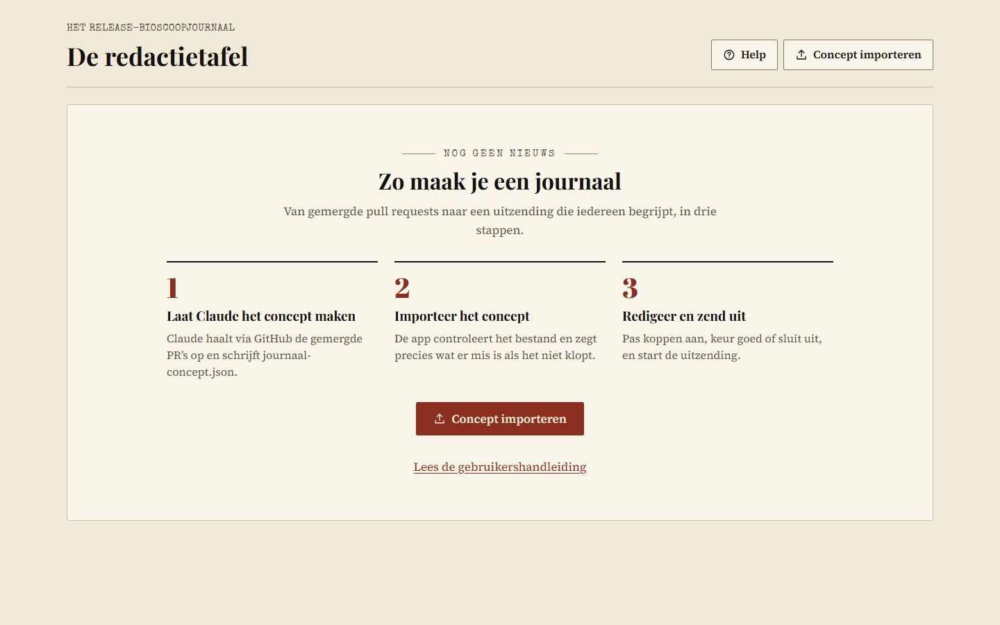
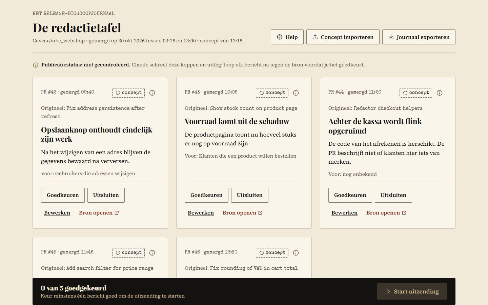
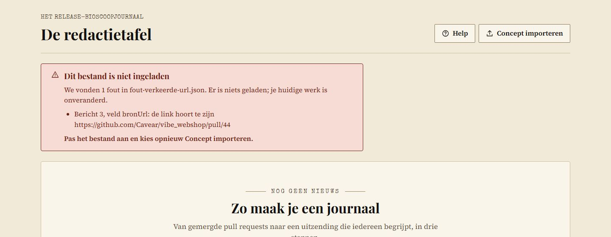
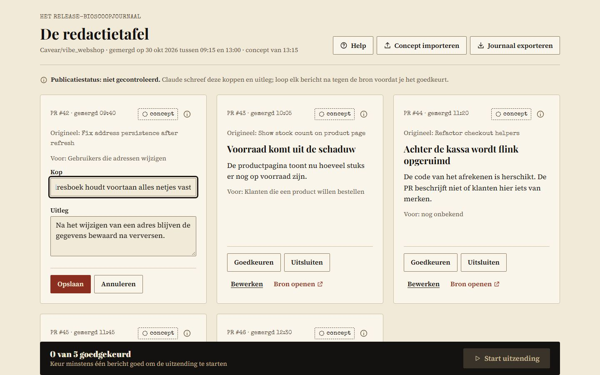
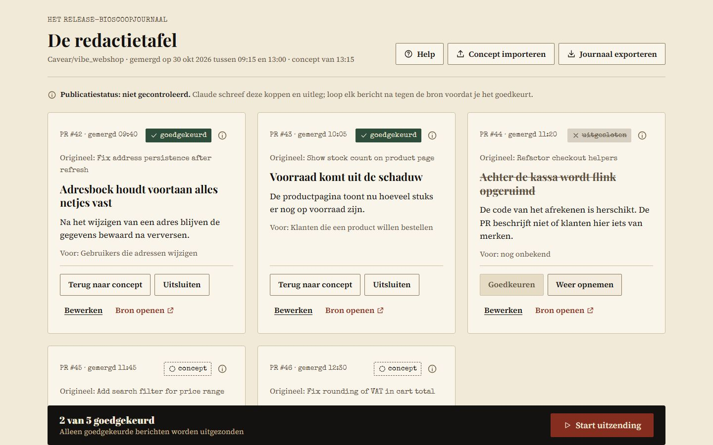
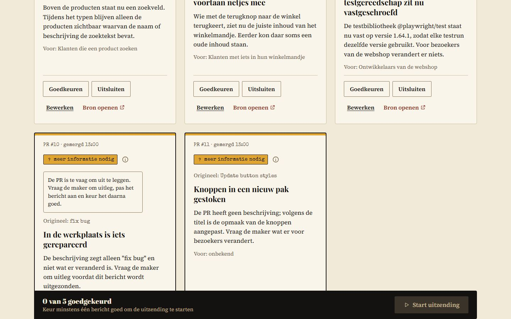
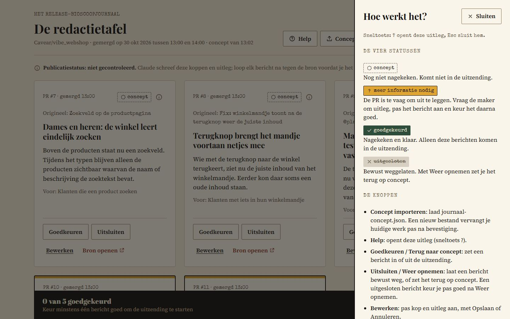
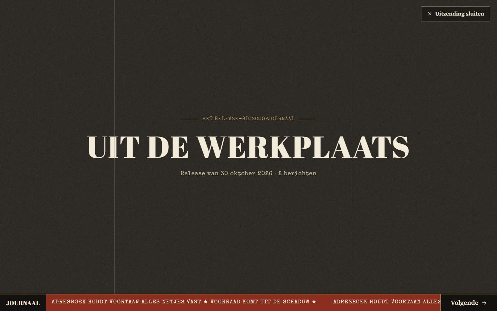
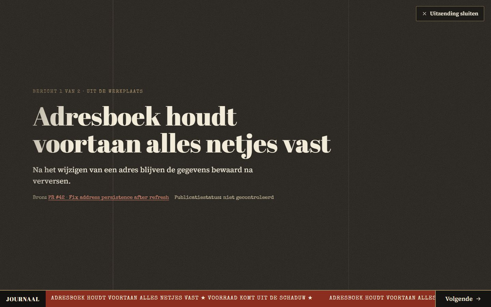
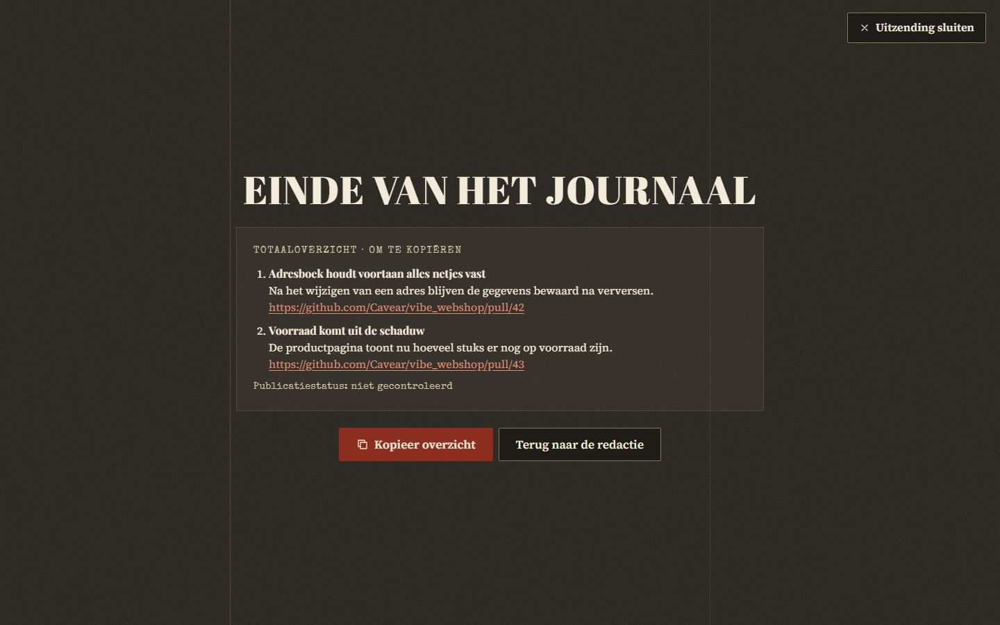

# Gebruikershandleiding

Met de Release-omroeper maak je van de gemergde pull requests van een release een kort journaal in de stijl van een oud bioscoopjournaal, om aan het team te presenteren.

Dezelfde tekst staat in de app zelf: `public/handleiding.html`, bereikbaar via *Lees de gebruikershandleiding* en via het Help-paneel. Pas bij een wijziging beide aan.

## 1. Het concept laten maken

Vraag Claude Code om `/journaal` voor een repository en een periode. Claude leest de gemergde PR's (alleen lezen) en schrijft `journaal-concept.json`: per PR een licht grappige kop, een zakelijke uitleg, voor wie het belangrijk is en een link naar de PR. Maximaal vijf berichten.

## 2. Het concept importeren

Kies *Concept importeren* en selecteer `journaal-concept.json`. De app controleert het bestand:

- **Klopt het**, dan zie je per bericht een kaart en de melding *n berichten ingeladen*.
- **Klopt het niet**, dan zie je *Dit bestand is niet ingeladen* met per fout het bericht en het veld, bijvoorbeeld *Bericht 3, veld bronUrl: …*. Er wordt niets geladen en je huidige werk blijft zoals het was. Pas het bestand aan en kies opnieuw *Concept importeren*.
- Staan er al berichten in de app, dan vraagt de app eerst of het nieuwe concept die mag vervangen.

## 3. De berichten nakijken

Loop elk bericht na tegen de bron (*Bron openen* opent de PR in een nieuw tabblad). Per kaart:

| Knop | Wat het doet |
|---|---|
| *Goedkeuren* / *Terug naar concept* | Zet het bericht in of uit de uitzending |
| *Uitsluiten* / *Weer opnemen* | Laat het bericht bewust weg, of zet het terug op concept |
| *Bewerken* | Pas kop en uitleg aan; *Opslaan* of *Annuleren* (Esc). Een lege kop of uitleg kan niet |
| *Bron openen* | Bekijk de pull request op GitHub |

Een uitgesloten bericht kun je niet direct goedkeuren: kies eerst *Weer opnemen*. Het ⓘ-icoon naast een statuslabel geeft een korte uitleg; *Help* (of de toets `?`) toont alle uitleg op één plek.

Onderaan staat de teller, bijvoorbeeld *2 van 5 goedgekeurd*. Na elke actie verschijnt kort een melding.

## De vier statussen

| Status | Betekenis |
|---|---|
| concept | Nog niet nagekeken. Komt niet in de uitzending. |
| meer informatie nodig | De PR is te vaag om uit te leggen. Vraag de maker om uitleg, pas het bericht aan en keur het daarna goed. |
| goedgekeurd | Nagekeken en klaar. Alleen deze berichten komen in de uitzending. |
| uitgesloten | Bewust weggelaten. Met *Weer opnemen* zet je het terug op concept. |

## Publicatiestatus: niet gecontroleerd

Claude schrijft de koppen en de uitleg op basis van de PR's. Dat kan fout zijn. Daarom staat *Publicatiestatus: niet gecontroleerd* bij elk bericht, ook in de uitzending. Gemergd betekent niet automatisch gepubliceerd.

## 4. De uitzending

Kies *Start uitzending* (kan pas als er minstens één bericht is goedgekeurd). Op volledig scherm volgt:

1. een aftelleader 3-2-1 (*Aftellen overslaan* slaat hem over);
2. de titelkaart *Uit de werkplaats*;
3. per goedgekeurd bericht één scherm met kop, uitleg en bron;
4. het eindscherm met het totaaloverzicht.

| Aftelleader | Titelkaart |
|---|---|
|  |  |

| Bericht | Eindscherm |
|---|---|
|  |  |

*Volgende* met de knop, het pijltje rechts of door naar links te vegen. Esc of *Uitzending sluiten* brengt je terug naar de redactie. Op het eindscherm kopieert *Kopieer overzicht* de koppen, uitleg en links; zonder HTTPS gebruikt de app een oudere kopieermethode, en lukt ook dat niet, dan selecteert de app de tekst zodat je hem zelf kopieert.

## 5. Het journaal exporteren

*Journaal exporteren* slaat het nagekeken journaal op als `journaal-nagekeken.json`, met je aangepaste koppen en statussen. Dat bestand kun je later opnieuw importeren om verder te werken.

Werk gaat niet ongemerkt verloren: staat er nog een niet-opgeslagen wijziging open, dan vraagt de app eerst of je toch wilt exporteren, en wie het tabblad sluit met werk dat nog niet is geëxporteerd, krijgt een waarschuwing van de browser.
