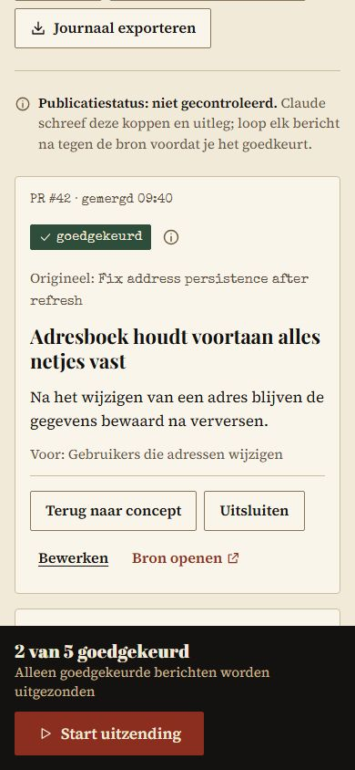
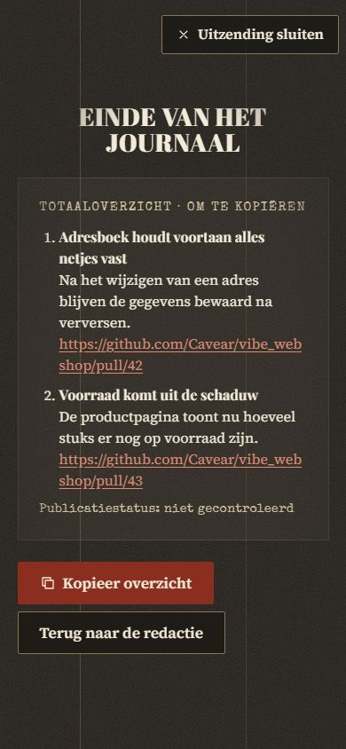

# Release-omroeper

Zet gemergde GitHub-pull requests om in een kort, licht komisch journaal in de stijl van een bioscoopjournaal uit de jaren vijftig: *Het Release-Bioscoopjournaal*.

## Wat doet de app en voor wie?

Na een release wil je het team en de stakeholders vertellen wat er veranderd is. PR-titels als *Refactor checkout helpers* zeggen daar weinig over. De Release-omroeper maakt van elke gemergde PR een nieuwsbericht. Dat bericht heeft een grappige kop en een zakelijke uitleg, en linkt naar de PR.

- **Voor de redactie** (degene die de release presenteert): nakijken, aanpassen, goedkeuren of uitsluiten.
- **Voor het publiek** (team, product owner, stakeholders): een korte uitzending op groot scherm, met aan het eind een overzicht om te kopiëren.

De grap zit altijd in de kop, nooit over personen. Een bericht is pas klaar als een mens het heeft nagelopen tegen de bron.

| Redactietafel (desktop) | Uitzending (desktop) |
|---|---|
|  |  |

| Redactietafel (mobiel) | Uitzending (mobiel) | Eindscherm (mobiel) |
|---|---|---|
|  |  |  |

## Live

- **Test:** http://app1-test.caitlinveenendaal.nl/ (elke merge naar `test`)
- **Productie:** http://app1.caitlinveenendaal.nl/ (elke merge naar `main`)

## Snel starten

Je hebt Node.js 22.12 of nieuwer nodig.

```bash
npm install
npm run lint        # codecontrole
npm run test:unit   # unit-tests (Vitest)
npm run test:ui     # UI-tests (Playwright) op mobiel, tablet en desktop
npm run serve       # de app op http://localhost:4173/
```

De app is een statische pagina zonder build-stap. `npm run serve` serveert `public/` lokaal; XAMPP (`http://localhost/Release_omroeper/public/`) werkt ook. Om meteen iets te zien: importeer `testdata/geldig-5-berichten.json`.

## Een journaal maken in 4 stappen

1. **Concept maken.** Vraag Claude Code om `/journaal` voor een repository en een periode. Claude leest de gemergde PR's alleen (read-only) en schrijft `journaal-concept.json`.
2. **Importeren.** Open de app en kies *Concept importeren*. Klopt het bestand niet, dan zie je per bericht en per veld wat er mis is, en wordt er niets geladen.
3. **Nakijken.** Loop elk bericht na tegen de PR (*Bron openen*). Pas zo nodig de kop of de uitleg aan en kies *Goedkeuren* of *Uitsluiten*.
4. **Uitzenden.** Kies *Start uitzending*. Alleen goedgekeurde berichten komen in beeld. Aan het eind kopieer je het totaaloverzicht.

## Demo-flow (5 minuten)

1. **Het probleem:** PR-titels als *fix bug* of *Update button styles* zeggen het publiek niets.
2. **Concept maken:** `/journaal Cavear/vibe_webshop 2026-10-30T13:00 2026-10-30T14:00` in Claude Code. Claude leest de PR's via de read-only GitHub MCP en schrijft het concept. Terugvaloptie: [`journaal/2026-10-30-oefenrepo/journaal-concept.json`](journaal/2026-10-30-oefenrepo/journaal-concept.json).
3. **Redigeren** op de productie-URL: importeren, de twee *meer informatie nodig*-berichten laten zien, een kop aanpassen, goedkeuren en uitsluiten.
4. **Uitzenden:** aftelleader, titelkaart, berichten met *Volgende*, eindscherm met *Kopieer overzicht*.
5. **Kwaliteit:** [PR #26](https://github.com/Cavear/Release-Omroeper/pull/26) zet de filter van de uitzending kapot; de pijplijn wordt rood op *conceptberichten komen niet in de uitzending* en er wordt niets gedeployd.
6. **De omroeper over zichzelf:** [`CHANGELOG.md`](CHANGELOG.md) is gemaakt door de app, van het journaal van deze release.

## Documentatie

- [Gebruikershandleiding](docs/gebruikershandleiding.md): de app stap voor stap gebruiken
- [Architectuur](docs/architectuur.md): van GitHub via het conceptbestand naar de webapp
- [Contract](docs/contract.md): het formaat van `journaal-concept.json` en de validatieregels
- [Testen](docs/testen.md): welke tests er zijn en hoe je ze draait
- [Aanpassingen op het plan](docs/plan-aanpassingen.md): waar we afwijken van het totaalplan en waarom
- [Ontwerp](docs/design/README.md): de goedgekeurde frames uit Claude Design
- [CHANGELOG.md](CHANGELOG.md): wat er in deze release zit, gemaakt door de omroeper zelf
- [CLAUDE.md](CLAUDE.md): stijlgids en bouwinstructies

## Werkafspraken

- Lokaal ontwikkelen, testen en accepteren op test, daarna naar productie. Elke merge naar `test` of `main` wordt na geslaagde tests automatisch gedeployd.
- Testen tijdens het bouwen, met bewijs per geplande teststap.
- Elk nieuwsbericht verwijst naar de oorspronkelijke pull request.
- Gemergd betekent niet automatisch gepubliceerd.
- Geen wachtwoorden of tokens in Git.
